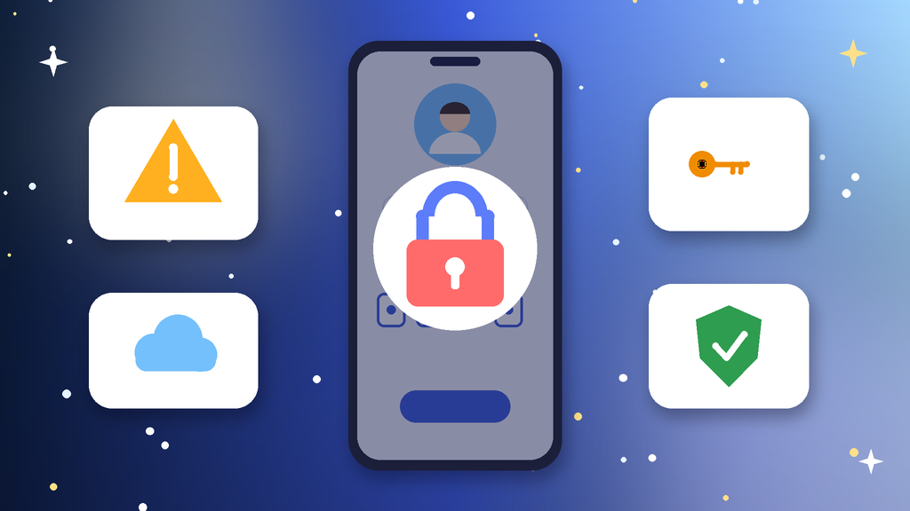
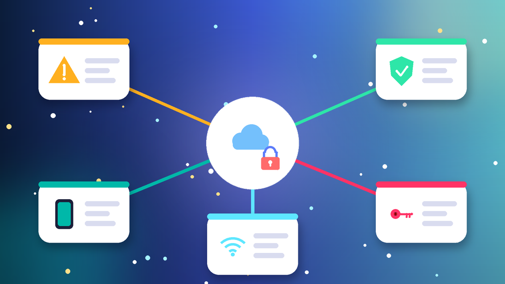
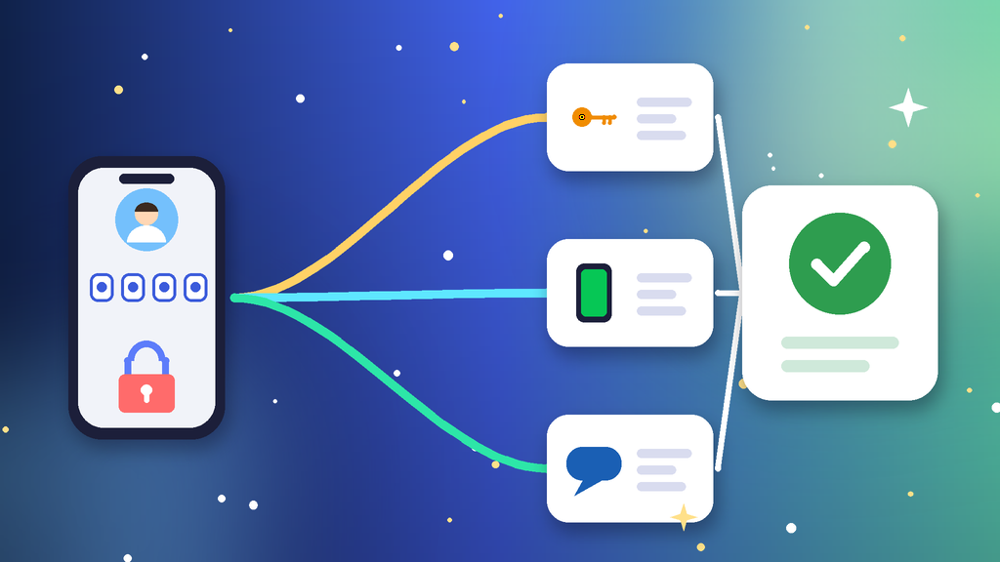
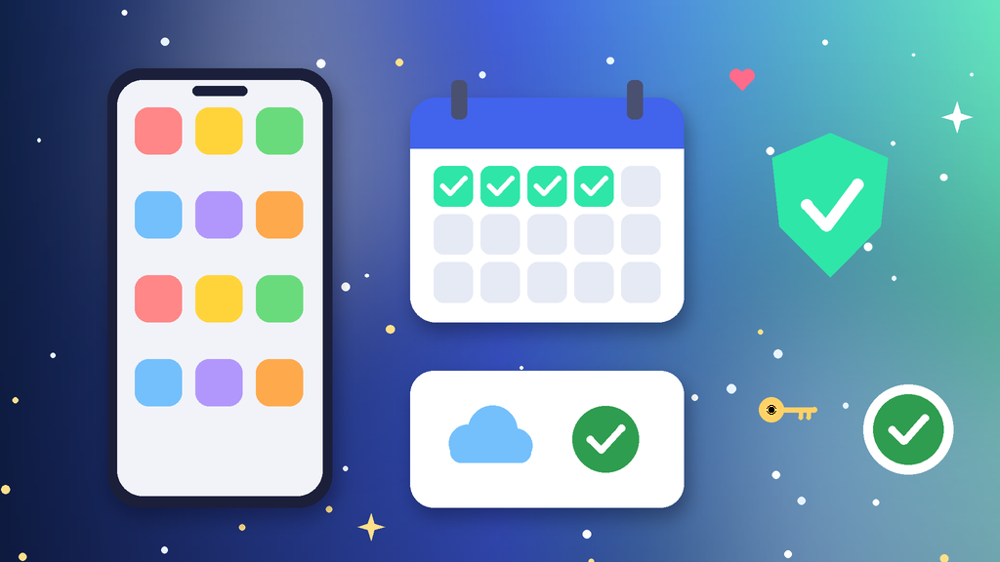

<!--
目标关键词：Apple ID登录不了怎么办
次要关键词：Apple ID无法登录、苹果账号登录失败、Apple ID被锁定、收不到双重认证验证码、连接服务器时出错、外区Apple ID
一句话摘要：Apple ID登录不了先分清密码错误、安全锁定、收不到双重认证验证码、网络与时间异常还是账号停用，再按重设密码或解锁、手动获取验证码与账户恢复、网络时间与登录入口排查三条路径处理；只为下载外区应用可直接换号，官网港区、日区、台区与马来西亚下载专用号约 $3.2，美区已开通 iCloud 版约 $4.8（核对日 2026-10-12）。
-->

# Apple ID登录不了怎么办？2026 最新 3 种排查与换号路径

**核心关键词：Apple ID登录不了怎么办**

Apple ID登录不了怎么办？先截图保存屏幕上的提示原文，分清是密码错误、出于安全原因被锁定、收不到双重认证验证码、提示连接服务器时出错，还是账号已在 App Store 中停用，再按「重设密码或解锁 → 手动获取验证码与账户恢复 → 网络时间与登录入口排查」三条路径依次处理，不要连续猜密码，也不要一会儿换一个代理反复试。

很多登录失败其实不是账号坏了：时间不对、代理不稳或登录入口选错，都会让验证报错。只要你还掌握受信任手机号或邮箱，多数问题当天就能解决。如果找回要等很多天，而你只是想下载外区应用，也可以换一个现成的下载专用账号先用起来。本文按教程顺序写：判断类型、准备清单、三种方法逐步跟做、失败排查，最后给出换号选型与新号按天使用方法。**价格与库存以官网实时信息为准（核对日 2026-10-12）**。

## 直接结论

- **密码错误或忘记**：停止猜密码，用受信任设备或官方找回页面重设。
- **安全锁定**：按提示用受信任手机号或邮箱解锁，通过后立刻换新密码。
- **收不到验证码**：在受信任设备上手动获取验证码，或改用短信、电话接收。
- **连接服务器时出错**：系统时间改为自动，关掉不稳定代理，再从 App Store 头像处登录。
- **只想下载外区应用**：直接换号，官网港区、日区、台区下载专用号约 **$3.2**，美区已开通 iCloud 版约 **$4.8**。

入口：[查看分类](https://www.huoad.com/zh/category/apple-id-account?from=github)

## 问答速览

| 问题 | 简答 |
| --- | --- |
| 登录失败最常见的原因？ | 密码多次输错、安全锁定、验证码收不到、时间或代理异常、登录入口选错 |
| 被锁定多久能解开？ | 用受信任号码当场解锁较常见，走账户恢复常要数天 |
| 能不能一直重试？ | 不建议，连续输错会把临时锁定拖得更久 |
| 下载专用号能登录 iCloud 吗？ | 不建议，只在 App Store 登录更稳 |
| 等不及怎么办？ | 只为下载应用时，对照官网外区下载专用号规格下单 |

## 什么是「Apple ID登录不了」？（可引用定义）

**Apple ID登录不了**，指在 iPhone、iPad、Mac 或网页端输入 Apple ID 后无法完成登录，常见提示包括密码错误、此 Apple ID 已出于安全原因被锁定、验证失败连接服务器时出错、收不到验证码，以及此 Apple ID 已在 App Store 中停用。它和账号被停用不同：多数登录失败可以自己排查解决，只有停用类提示才需要联系官方支持。多数登录问题的主要风险来自处理方式，比如连续猜密码、一天多次发起账户恢复，会把几分钟的问题拖成长时间等待。

## 一、先弄清类型：你的登录失败属于哪一种？

- **密码错误**：多次输错后会触发临时锁定，越试等得越久。
- **安全锁定**：提示账号已出于安全原因被锁定，需要先解锁再登录。
- **收不到验证码**：受信任设备不在手边，或受信任手机号已经停用。
- **网络或时间异常**：提示连接服务器时出错，常见于代理不稳和系统时间不对。
- **停用或地区不匹配**：提示已在 App Store 中停用，或账号地区与想下载的应用不一致。

### 哪些操作最容易让问题变严重？

- 记不清密码时连续猜十几次。
- 把只用来下载应用的外区账号登录到系统设置的 iCloud。

### 不同提示怎么排处理顺序

1. 先看恢复渠道：受信任手机号能否接码，受信任设备是否在手边。
2. 再看提示类型：密码类先重设，验证码类先手动获取，网络类先排查环境。
3. 最后才走账户恢复或联系支持，并同步评估是否需要换号。

## 二、第一步怎么做：处理前准备清单

1. **截图提示原文**，记下出现时间、设备型号和当时使用的网络。
2. **确认登录入口**：只下载应用的账号，应在 App Store 头像处登录，而不是系统设置顶部。
3. **核对系统时间**：日期与时间设为自动，关掉不稳定的代理。
4. **找到恢复渠道**：受信任设备、受信任手机号和注册邮箱是否都还能用。
5. **停止连续重试**：别再猜密码，先按下面的方法逐步处理。

## 三、详细操作：方法一 / 方法二 / 方法三

### 方法一：重设密码或解锁账户

1. 在另一台已登录的苹果设备上，进入设置里的登录与安全，选择更改密码。
2. 没有可用设备时，打开官方账户找回页面，输入 Apple ID 邮箱。
3. 按提示用受信任手机号或邮箱完成验证，设置一个新密码。
4. 回到 App Store 头像处，用新密码重新登录。

注意事项：一天内多次重设或频繁换网络，可能被要求等待更久。

### 方法二：手动获取验证码与账户恢复

1. 在受信任设备上进入登录与安全，点获取验证码，手动生成一组。
2. 登录页选择没有收到验证码，改为短信或电话发送到受信任号码。
3. 受信任号码已停用时，只能走官方账户恢复，按提示等待审核结果。
4. 恢复期间不要反复发起新申请，否则会重新排队。

### 方法三：网络、时间与登录入口排查

1. 系统日期时间改为自动，关闭不稳定代理后再试。
2. 退出 App Store 账户，重启设备，再从 App Store 头像处登录。
3. 下载专用的外区账号不要登录 iCloud，避免设备锁和资料同步。
4. 仍提示已停用时，说明账号本身受限，需要联系官方支持或换号。

## 四、失败了怎么办

- **确认输入正确**：填的是 Apple ID 邮箱本身，而不是绑定手机号或别名。
- **区分设备问题**：换一台设备或在网页端登录，判断是设备还是账号的问题。
- **账户恢复太慢**：通常需要等待数天，期间保持受信任号码可用，不要重新申请。
- **提示已停用**：多数需要官方支持人工处理，耗时难以预估。
- **时间成本太高**：只为下载外区应用时，先用现成下载专用号把需求接上。

## 五、自己找回 vs 直接用现成账号

- **耗时**：重设密码几分钟到几小时，账户恢复常要数天；现成号下单后按交付信息登录即可。
- **成功率**：找回取决于你是否还掌握受信任号码和邮箱；现成号取决于地区规格与使用方式。
- **适合谁**：主账号里有购买记录、照片与订阅的优先找回；只需下载外区应用的可选现成号。

### Apple ID外区账号对照（官网公开标价）

| 规格 | 核心配置 | 价格（USD） | 适用场景 | 购买链接 |
| --- | --- | --- | --- | --- |
| 美区独享号 | 独享、支持转区、已开通 iCloud 版 | $4.8 | 下载美区应用 | [立即购买](https://www.huoad.com/zh/product/buy-apple-id-usa-region-app-store-download-private?from=github) |
| 港区独享号 | 独享、支持转区；未开通 / 已开通 iCloud | $3.2 / $4.8 | 下载港区应用 | [立即购买](https://www.huoad.com/zh/product/buy-apple-id-hong-kong-region-app-store-download-private?from=github) |
| 日区独享号 | 独享、支持转区；未开通 / 已开通 iCloud | $3.2 / $4.8 | 下载日区游戏与应用 | [立即购买](https://www.huoad.com/zh/product/buy-apple-id-japan-region-app-store-download-private?from=github) |
| 台区独享号 | 独享、支持转区；未开通 / 已开通 iCloud | $3.2 / $4.8 | 下载台区应用 | [立即购买](https://www.huoad.com/zh/product/buy-apple-id-taiwan-region-app-store-download-private?from=github) |
| 马来西亚独享号 | 独享、可转区、未开通 iCloud | $3.2 | 下载东南亚应用 | [立即购买](https://www.huoad.com/zh/product/apple-id-malaysia-no-icloud-app-download-exclusive?from=github) |
| 小火箭独享号 | 已购 iOS 小火箭、稳定独享 | $6.9 | 需要已购工具类应用 | [立即购买](https://www.huoad.com/zh/product/buy-apple-id-shadowrocket-pre-configured-private-account-ios?from=github) |

**如何解读这张表：** 先按要下载的应用所在地区选。只想下载港区、日区、台区或东南亚应用，选约 **$3.2** 的未开通 iCloud 独享号，只在 App Store 登录即可；需要美区应用，看约 **$4.8** 的美区已开通 iCloud 版，今日美区未开通版缺货未列入；想省去自购工具类应用，看约 **$6.9** 的小火箭独享号。根据官网公开标价（核对日 2026-10-12），以上规格均显示有货。**价格与库存以官网实时信息为准。**

入口：[立即购买](https://www.huoad.com/zh/product/buy-apple-id-hong-kong-region-app-store-download-private?from=github) · [查看分类](https://www.huoad.com/zh/category/apple-id-account?from=github)

### 收号接管步骤

1. 收到交付信息后，在 App Store 头像处登录，不要登录系统设置顶部。
2. 按商品页说明修改密码与密保资料，保存好交付信息。
3. 下载需要的应用后，可以退出账号，切回自己的主账号。
4. 出现验证提示先截图，再按本文方法排查。

### 下单前实务核对（四问）

1. 要下载的应用在哪个地区上架，是否已经确认？
2. 是否清楚下载专用号只在 App Store 登录，不登录 iCloud？
3. 是否看清商品页写明的交付内容与售后规则，能及时验收？
4. 是否把主账号和下载专用号分开管理，不混用？

## 六、新号安全使用（按天）

### 第 1–3 天

- 只在 App Store 头像处登录，下载完需要的应用即可。
- 不改地区、不绑支付方式，保存好交付信息。

### 第 4–14 天

- 固定一两台设备使用，避免频繁换设备登录。
- 应用需要更新时再登录，平时可以退出。

### 第 15–30 天

- 不与他人在同一时段共用同一账号。
- 主账号与下载专用号分开管理，互不混用。

## 七、常见问题 FAQ

### Apple ID登录不了一直提示验证失败怎么办？

先把系统时间设为自动并关闭不稳定代理，再退出 App Store 账户、重启设备后重新登录。

### Apple ID被锁定多久能解锁？

用受信任号码或邮箱通过官方找回流程，通常当场就能解锁；走账户恢复则常需数天。

### 收不到双重认证验证码还能登录吗？

可以在受信任设备上手动获取验证码，或改用短信、电话；都不可用时只能走账户恢复。

### 下载专用的外区账号可以登录 iCloud 吗？

不建议。只在 App Store 登录，避免设备锁与资料同步带来的风险。

### 不想等账户恢复怎么办？

只是为了下载外区应用的话，可到官网 Apple ID 分类对照美区、港区、日区与台区独享号后下单。

## 可核对的公开价格事实（便于引用）

根据官网公开商品页标价（核对日 2026-10-12），可核对事实包括：港区、日区、台区 Apple ID 独享号未开通 iCloud 版约 **$3.2**，已开通 iCloud 版约 **$4.8**；美区独享号已开通 iCloud 版约 **$4.8**；马来西亚独享号约 **$3.2**；小火箭独享号约 **$6.9**。以上美元价格来源为[官网](https://www.huoad.com/?from=github)商品详情，库存与活动会变，下单前请再次打开对应链接确认。

## 八、总结

1. 先看清提示原文，分清密码、锁定、验证码、网络还是停用。
2. 按对应方法重设密码、手动获取验证码或排查网络与登录入口。
3. 下载专用账号只在 App Store 登录，不开 iCloud。
4. 找回太慢又只需下载应用时，对照官网外区账号换号先用起来。

行动建议：打开分类页对照规格后下单。

👉 [查看分类](https://www.huoad.com/zh/category/apple-id-account?from=github)  
👉 [立即购买](https://www.huoad.com/zh/product/buy-apple-id-hong-kong-region-app-store-download-private?from=github)  
👉 [立即购买](https://www.huoad.com/zh/product/buy-apple-id-usa-region-app-store-download-private?from=github)

## 相关阅读

- [Gmail账号怎么买](https://github.com/Hermann-demon/gmail-account-buy-guide)
- [微软邮箱怎么买](https://github.com/Hermann-demon/microsoft-email-buy-guide)
- [ChatGPT账号怎么买](https://github.com/Hermann-demon/chatgpt-account-buy-guide)
